# Archived Legacy Note

- Original path: `ObsidianVault/Blockers/Blockers.md`
- Archive reason: Planning/blocker/hypothesis material is not Canon unless evidence-backed claims are extracted.

> This note is preserved for provenance. Do not treat its claims as current Canon unless a Canon note explicitly promotes them.

## Original note

---
title: Blockers
type: dashboard
updated: 2026-06-21
tags: [dashboard, blockers, due-diligence, risk, readiness]
---

# 🚧 Blockers & RE-Readiness — due-diligence dashboard

> A **read-only** technical due-diligence pass (2026-06-18) over the whole project, scoped to *a full reverse-engineering / decompilation / asset-preservation / build-reproduction effort* — a deliberately harder yardstick than the project's actual modding goals. It catalogs every significant **blocker, unknown, assumption, risk, and gap**, with evidence and confidence. It **documents** conflicts; it does not resolve or edit the existing notes. Companion views: **[[Risk Matrix]]** · **[[Assumptions Register]]** · existing unknowns in **[[Open Questions]]** · belief graveyard in **[[Hypotheses]]**.
>
> **Method/provenance:** four parallel read-only corpus sweeps (`docs/`, `src_re_geometry/`, `src_re/`+`tools/`, and the disc/asset landscape under `REBUILD/files/`) + an audit of this vault. Confidence vocab is the vault standard ([[API - determinism]]): `CONFIRMED · LIKELY · INVESTIGATING · UNKNOWN`. Here, confidence grades *the blocker claim itself* (how sure we are the gap is real), not the underlying RE finding.

> [!important] Two yardsticks — read this first
> Measured against its **actual pursued goals** (targeted behavioral RE + LEVEL01 modding: move pickups, deform the visible floor, recolor/replace the sky, move seeds, inject GPU primitives), this project is **disciplined and largely succeeding** — the vault is an unusually rigorous knowledge graph. Measured against a **complete, reproducible, matching decompilation + full asset pipeline + byte-exact disc rebuild**, it is **early-stage**: ~0.3–0.5 % of the executable is decompiled, entire asset subsystems are untouched, and the verification layer is not reproducible by a third party. Every score below is against the *second* (full-RE) yardstick. Nothing here detracts from the quality of the work already done; it maps how far the summit still is.
>
> [!note] Charter relationship (recorded 2026-06-20; reconciled per [[Gap Audit|GAP-0043]] 2026-06-21)
> The project's **controlling** goal is **modding-grade behavioral RE + LEVEL01+ modding**, method **decomp-forward** — see the charter callout in [[Roadmap]] and [[CONTRIBUTING]]. **This entire dashboard — its scorecard and the 🔴/🟠/🟡 severities — grades the *optional harder yardstick* (full / matching RE + preservation), kept as a progress gauge, not a pass/fail bar.** Matching / byte-identical decompilation is **optional** and is never required without a direct modding payoff. So "🔴 Critical" here means "critical *to a hypothetical full-RE/preservation effort*", **not** "blocks the project": e.g. [[Blocker - Decompilation has no build or symbol substrate|B1]] is **deferred / payoff-gated** under the charter, while its enabling halves (symbols [[Gap Audit|GAP-0018]], overlays [[Gap Audit|GAP-0020]]) are active. Read severities through this lens.

## Executive summary (feasibility)
- **Feasible, but the "full RE" is barely begun and currently un-reproducible.** The hard PS1-specific unknowns that usually sink such efforts are mostly *favorable* here: the toolchain is **identifiable** (PsyQ / PROPACK / Iguana — ground-truth sits unmined on the disc, [[Blocker - Original toolchain ground-truth is unmined|B13]]), and the untouched audio/video formats are **industry-solved** (XA, MDEC, VAB → [[Blocker - Audio subsystem is completely unanalyzed|B5]]/[[Blocker - FMV video is completely unanalyzed|B6]]). So the ceiling is high.
- **The four things most likely to prevent a *full* effort are not asset puzzles — they are infrastructure and epistemics:** (1) there is **no build/link/diff/symbol substrate** so the decompiled C cannot be verified against the binary ([[Blocker - Decompilation has no build or symbol substrate|B1]]); (2) the **entire dynamic-evidence layer is bus-factor-1** on a private DuckStation fork + un-versioned save states + operator eyeballing ([[Blocker - Verification is bus-factor-1 on a private emulator fork|B2]]); (3) several **headline "CONFIRMED" results are single-sourced and have flipped before** — e.g. the contradiction about which file renders the visible floor (since **resolved** → f13/LEVEL.DAT, M7; the single-source *pattern* persists) ([[Blocker - Headline results rest on single-source evidence|B3]]); (4) **byte-exact disc reproduction is unproven** ([[Blocker - Byte-exact disc reproduction is unproven|B4]]).
- **Net:** continue the modding track with confidence, but treat the "full decompilation / preservation" framing as *not yet started* in the reproducible sense. The cheapest high-value moves are capturing the on-disc toolchain ground-truth, versioning the environment, and re-validating the geometry headline with the reproducible VRAM-diff harness the project already built.

## Progress — remediation Phase 1 (2026-06-18)
First offline pass executed (tracker: [[Remediation Plan]]). Status changes:
- ✅ **B13 resolved** — toolchain captured (Traveller's Tales · PsyQ + PsyMake 1.11 · PROPACK 2.29 · `lbmbugs`) → [[Finding - Build toolchain and PROPACK provenance]]. (Iguana = PROPACK licensee, *not* the developer — corrected.)
- ✅ **B12 resolved (provenance half)** — `.bin` = verified **USA V1.0** (CRC32 `607704bb` / MD5 `2c3861a3…` match public hashes; V1.1 rerelease differs). Regional/proto diffing still open.
- 🟢 **B9 inventory built** — full 69-row chunk inventory (3 regions) → [[MEM - LEVEL.RAW chunk inventory]]. *(Audit 2026-06-22: this is taxonomy, not semantics — only **3/69** chunks have a verified semantic role; the rest are format-class labels. Not "resolved.")*
- ✅ **B6 resolved (extraction)** — jpsxdec decodes the STR/MDEC FMV (`INTRO` 320×128, 1750 frames + XA); tool now in-repo.
- 🟢 **B20 advanced** — `GFX/*.RAW` are PROPACK (decode with the existing codec); `TTLOGO.BGR` decoded. Remaining: bpp/CLUT + the font/text store.
- 🟢 **B5 advanced** — XA streaming extractable via jpsxdec (`AUDIO1` = 8 stereo ch @ 37.8 kHz). Remaining: **VAB** sound banks need a VAB tool.
- 🟢 **B7 narrowed** — `.ALL`/`.ANM` are **uncompressed** (not codec-gated); still need bespoke-format loader RE.
- ✅ **B4 core resolved** *(Phase 2c)* — whole-image rebuild is **byte-exact** (0/313,897 sectors differ) → [[Finding - Disc rebuild is byte-exact]]; B4 downgraded Critical→Medium (only size-changing/compressed-edit cases remain).
- ✅ **B11 vault-reconciled** *(Phase 2a)* — codec status corrected (decode solved / re-inject unproven); visible-floor contradiction flagged for Phase 3.
- ⏭️ Next: finish Phase 2 (repro tidy) + operator-gated **Phase 3** (geometry re-validation; codec boot-test).

## ⚠️ Audit reconciliation (2026-06-22) — supersedes stale severities below
A deep evidence-verified re-audit of all 20 blockers (each checked against actual repo files, conservative "close only if completely verified" rule). **The severity lists, scorecard text, dependency graph, and consolidated-unknowns counts further down this page predate 2026-06-20→22 work and are STALE.** Corrected dispositions (authoritative; individual blocker notes carry the full reconciliation):

| ID | Old (this dashboard) | Verified TRUE status (2026-06-22) |
|---|---|---|
| **B2** | 🔴 Critical | **Partially addressed → Medium.** Fork pinned, paths parametrized, vault/findings/tools tracked — but `git remote -v` is **empty** (no off-host remote) so host bus-factor is still 1. NOT "Low/resolved." |
| **B3** | 🔴 Critical | **Partially addressed → Medium.** Floor-render instance closed (≥2 methods, G29 Pass-3 SHA-identical collision table); general single-source pattern persists across un-rechecked corpus. |
| **B4** | 🔴 Critical *(listed)* | **Partially addressed → Medium.** Unpatched whole-image rebuild byte-exact (independently re-verified via mkpsxiso→cmp). LBA-shift/compressed-edit/regression-script still open. (Self-contradiction: Progress already says Medium.) |
| **B5** | 🟠 Major | **Partially addressed.** Audio *extraction* fully resolved (`tools/extract_vab.py`, 1771 VAG + 40 XA WAVs) — title "completely unanalyzed" is false; runtime engine path open (GAP-0031). |
| **B6** | 🟠 Major | **Resolved as scoped.** 39 AVIs = 39 .STR; FMV.BIN manifest + front-end sequence decoded (GAP-0032). One overlay-internal MDEC residual. |
| **B7** | 🟠 Major | **Partially addressed → Medium.** Geometry + skinning mechanism decoded; vertex→bone binding REFUTED-open; no committed extractor. |
| **B8** | 🟠 Major | **Partially addressed (near).** Floor model + collision generalized to LEVEL02/L03 (motion-validated, GAP-0039); streaming/caching loader unmodeled; no live cross-level edit. |
| **B9** | "resolved" / "3/69 open" | **Partially addressed.** 69/69 classified; **3/69** with verified semantic role. |
| **B10** | "1/11 … 10/11 open" | **Partially addressed.** 11/11 top-level roles identified (rec1 confirmed, rec2-10 by-format); pass-3 placement / rotation / source-scalars open. |
| **B11** | 🟠 Major | **Open (partially).** 4/6 catalogued contradictions fixed; G29 "PLAN ONLY" header, G30 status drift, and this dashboard's own B2/B13 drift still live. |
| **B12** | 🟠 Major | **Partially addressed.** Provenance half resolved (USA V1.0, CRC32 607704bb → [[Checksum Manifest]]); formal Redump datfile + regional diffing open. |
| **B13** | ✅ Resolved | **Resolved (core).** Toolchain captured; note body had stale "uncaptured"/Iguana-as-developer text (corrected). |
| **B14** | 🟡 Medium | **Partially addressed.** Decode byte-exact; recompressor is game-accepted (modding) but does **NOT** reproduce original bytes (~1.4× literal stream) — titled blocker structurally unresolved. |
| **B18** | 🟡 Medium | **Partially addressed (near) → Low.** Floor+wall+slide resolver decoded & live-edit-validated; only PATH*.BIN nav-graph (shelved) + minor resolver internals open. |
| **B19** | 🟡 Medium | **Partially addressed.** Workflow-race mitigated; DMA/scratchpad/NEUTRALIZE are permanent method limits (worked around, not closed). |
| B1, B15, B16, B17 | as listed | **Unchanged status, notes refreshed** — B1 partial (Ghidra cross-check ≠ build substrate); B15 map now exists+validates (≈2–3% coverage); B16 truly unresolved; B17 overlay-enum resolved (GAP-0020), boundary residual open. |

**Net: 0 blockers FULLY closed by the conservative bar; B6 and B13 are "resolved as scoped / core-resolved" with named residuals; the rest are genuinely partial/open.** The 🔴/🟠/🟡 lists, scorecard, mermaid, and "Unknowns (consolidated)" counts below are retained for history but are corrected by this table.

## RE-Readiness scorecard (0–10, vs. the full-RE yardstick)
> Scores below are the **original baseline**. Post Phase 1–2 (2026-06-18): **Asset 3→5 · Toolchain 3→6 · Documentation 5→6 · Build-reproduction 2→6 · Overall ≈2.5→≈3.7** (Executable & Decompilation unchanged). See the Progress section above.
>
> **Gauge, not goal:** these scores measure the **optional** full-RE/preservation yardstick ([[Gap Audit|GAP-0043]]), **not** the controlling modding charter — see the charter-relationship note at the top. A low "Decompilation readiness" or "Executable understanding" is *expected and acceptable* under the charter; it is not a project deficiency.

| Dimension | Score | Justification (evidence) |
|---|:--:|---|
| **Executable understanding** | **2** | ~9 functions with real C bodies + ~27 documented behaviorally, out of an estimated **1,875–3,126** in the 468,991-byte resident image (`docs/EXECUTABLE_AND_OVERLAYS.md`); one vertical slice (pickup→HUD→render→collision→load) on LEVEL01. Overlays, GTE/render core, audio, AI, `main`/frame-driver un-analyzed. → [[Blocker - Decompilation has no build or symbol substrate|B1]] |
| **Asset understanding** | **3 → ~5** *(2026-06-22)* | LEVEL.DAT type-0x3f pickups solved; LEVEL.RAW codec decode byte-exact. *Corrected counts:* all **69/69** RAW chunks classified (**3/69** with verified semantic role); **11/11** DAT top-level record roles identified (rec1 confirmed, rest by-format). Audio/FMV now **extracted** (1771 VAG + 40 XA WAVs; 39 FMV AVIs); models/textures format-decoded but no committed extractor. → [[Blocker - LEVEL.RAW chunk inventory is mostly unidentified|B9]] · [[Blocker - LEVEL.DAT non-pickup records are undecoded|B10]] |
| **Toolchain understanding** | **3** | Ground-truth **exists** on-disc (PsyQ + PsyMake 1.11 + PROPACK 2.29 + Iguana, `REBUILD/files/LEVEL00/ERRORS.ERR`) but is **uncaptured**; no PsyQ version pinned, no library census, no recompile attempted. Cheaply raised. → [[Blocker - Original toolchain ground-truth is unmined|B13]] |
| **Documentation completeness** | **5** | Genuinely strong depth + cross-linking for the pursued tracks, but **stale/contradictory** in load-bearing places (codec "solved" vs "gate" across ≥4 notes; chunk-35 over-claim; G29 "PLAN ONLY" header; findings-store contradictions) and **silent on whole subsystems**. High variance. → [[Blocker - Project documentation is stale and contradictory|B11]] |
| **Decompilation readiness** | **1** | No Makefile / linker script / `splat` config / symbol map / persisted disassembly DB anywhere; C is `#include "re_types.h"` + `extern` stubs + addresses-as-lvalues — **un-compilable, un-diffable**. → [[Blocker - Decompilation has no build or symbol substrate|B1]] |
| **Build-reproduction readiness** | **2** | A size-preserving LEVEL01 DAT-patch rebuild that **boots** works; but no whole-image bit-equality proof, EDC/ECC unverified, recompressor literal-only/never-booted, LBA-shift handling unproven, no Redump provenance. → [[Blocker - Byte-exact disc reproduction is unproven|B4]] |
| **Overall (full RE)** | **≈2.5** | Excellent *targeted* RE; as a complete/reproducible decompilation + preservation effort, early-stage and not third-party-reproducible. |

## Blockers by severity
> Severities are graded against the **optional full-RE yardstick** (see the charter note up top); under the controlling modding charter the "Critical" items are **payoff-gated, not project-blocking**.

**🔴 Critical** — likely to prevent meaningful progress toward a *full* RE:
- [[Blocker - Decompilation has no build or symbol substrate]] (B1)
- [[Blocker - Verification is bus-factor-1 on a private emulator fork]] (B2) — *⚠️ corrected 2026-06-22 → **Medium** (partially addressed; only residual = no off-host remote)*
- [[Blocker - Headline results rest on single-source evidence]] (B3) — *⚠️ corrected 2026-06-22 → **Medium** (floor instance closed; pattern persists)*
- [[Blocker - Byte-exact disc reproduction is unproven]] (B4) — *⚠️ corrected 2026-06-22 → **Medium** (unpatched rebuild byte-exact)*

**🟠 Major** — significantly slow progress / whole subsystems missing:
- [[Blocker - Audio subsystem is completely unanalyzed]] (B5) — *⚠️ corrected 2026-06-22 → **Low**; extraction done (1771 VAG + 40 XA WAVs), runtime path open (GAP-0031)*
- [[Blocker - FMV video is completely unanalyzed]] (B6) — *⚠️ corrected 2026-06-22 → **resolved as scoped**; 39 AVIs + FMV.BIN sequence (GAP-0032), one overlay residual*
- [[Blocker - Character and plant model formats are unreversed]] (B7)
- [[Blocker - RE depth is LEVEL01-only]] (B8)
- [[Blocker - LEVEL.RAW chunk inventory is mostly unidentified]] (B9)
- [[Blocker - LEVEL.DAT non-pickup records are undecoded]] (B10)
- [[Blocker - Project documentation is stale and contradictory]] (B11)
- [[Blocker - Disc provenance is unverified]] (B12)
- [[Blocker - Original toolchain ground-truth is unmined]] (B13)

**🟡 Medium** — raise effort / uncertainty:
- [[Blocker - Recompressor cannot reproduce original compression]] (B14)
- [[Blocker - Symbol recovery has no authoritative map]] (B15)
- [[Blocker - Struct and type recovery is shallow]] (B16)
- [[Blocker - Function boundaries and overlays evade the static call graph]] (B17)
- [[Blocker - Collision internals are partly undecoded]] (B18)
- [[Blocker - Analysis methods have systematic blind spots]] (B19)
- [[Blocker - Offline texture and font extraction is absent]] (B20)

**🟢 Minor** — useful but not project-threatening: these are already catalogued by the project as format/semantics loose ends — see **[[Open Questions]] P3–P5** (payload `attr` field, LIST_B consumer, entry24 runtime-rewrite, horizontal viewport→pixel map, pickup kinds `0x31`/`0x2c`/`0x2d`/`0x30`, controller/libpad location, per-level identity maps). Not re-catalogued here to avoid duplicating that note.

## Dependency graph
> Arrow `A --> B` = "resolving B is blocked/contingent on A." Two cross-cutting roots (B2, B12) sit under almost everything because they underwrite, respectively, the *dynamic* evidence and the *static* offsets.

```mermaid
flowchart TD
  B2[B2 private-fork reproducibility]:::crit
  B12[B12 unverified provenance]:::major
  B13[B13 toolchain unmined]:::major
  B1[B1 no build/symbol substrate]:::crit
  B3[B3 single-source headline results]:::crit
  B4[B4 byte-exact rebuild unproven]:::crit
  B14[B14 recompressor not original]:::med
  B9[B9 RAW chunk inventory]:::major
  B10[B10 DAT records]:::major
  B8[B8 LEVEL01-only]:::major
  B19[B19 method blind spots]:::med
  B18[B18 collision internals]:::med
  B15[B15 no symbol map]:::med
  B16[B16 struct recovery]:::med
  B17[B17 boundaries/overlays]:::med
  B5[B5 audio]:::major
  B6[B6 FMV]:::major
  B7[B7 model/anim .ALL/.ANM]:::major
  B20[B20 textures/fonts]:::med
  B11[B11 doc staleness]:::major

  B2 --> B3
  B19 --> B3
  B2 --> B19
  B12 --> B1
  B12 --> B4
  B13 --> B1
  B13 --> B14
  B13 --> B7
  B13 --> B20
  B1 --> B15
  B1 --> B16
  B1 --> B17
  B14 --> B4
  B9 --> B4
  B19 --> B18
  B8 --> B9
  B8 --> B10
  B9 --> EDIT[permanent terrain/collision/seed disc edits]
  B14 --> EDIT
  B10 --> EDITOR[full level editor]
  B9 --> EDITOR
  B1 --> DECOMP[matching decompilation]
  B13 --> DECOMP
  classDef crit fill:#3b0d0d,stroke:#e25555,color:#ffd9d9;
  classDef major fill:#3a2a0d,stroke:#d99a2b,color:#ffe9c7;
  classDef med fill:#0d2a3a,stroke:#2b8ad9,color:#c7e6ff;
```

## Unknowns (consolidated)
**A. Already catalogued by the project** (geometry/collision/pickup semantics): see **[[Open Questions]]** (P1–P5) and the open rows in **[[Hypotheses]]** (H-A…H-D). Not duplicated here.

**B. Surfaced or sharpened by this audit** (mostly whole-subsystem unknowns the project's own Open Questions is silent on):
- **Audio**: XA channel→cue map; whether music is XA-streamed vs sequenced (no `.SEQ`/`.SEP` found); VAB program/tone layout. → [[Blocker - Audio subsystem is completely unanalyzed|B5]]
- **Video**: per-`.STR` frame/audio layout; the front-end sequence (`INTRO`/`DLOGO`/`TT`). → [[Blocker - FMV video is completely unanalyzed|B6]]
- **Models/animation**: the bespoke Iguana `.ALL`/`.ANM` grammar. → [[Blocker - Character and plant model formats are unreversed|B7]]
- **Text/fonts**: where on-screen text lives (no strings in EXE; likely image-baked) and the glyph/blit path. → [[Blocker - Offline texture and font extraction is absent|B20]]
- **Level/format breadth** *(counts corrected 2026-06-22)*: **66/69 RAW chunk semantic roles** still open (all 69 classified; 3 with verified role); **DAT records — 11/11 top-level roles now identified** (residuals: pass-3 placement, per-instance rotation/scale, G2 source scalars); the 15-variant→10-dir stage map; mid-level **streaming/caching loader still unmodeled**; the reloc flag-`0x20` path (never exercised). → [[Blocker - LEVEL.RAW chunk inventory is mostly unidentified|B9]] · [[Blocker - LEVEL.DAT non-pickup records are undecoded|B10]] · [[Blocker - RE depth is LEVEL01-only|B8]]
- **Toolchain**: exact PsyQ/compiler version; whether PROPACK packs other `.RAW`/`.ALL`; `lbmbugs` `32 256 128` palette/width/height semantics. → [[Blocker - Original toolchain ground-truth is unmined|B13]]
- **Provenance**: the master `.bin`'s Redump identity; existence of PAL/NTSC-J/proto for diffing. → [[Blocker - Disc provenance is unverified|B12]]
- **Overlays**: Region-A overlay source file + ABI; `fmv.bin` role. → [[Blocker - Function boundaries and overlays evade the static call graph|B17]]
- **Build integrity**: whole-image byte-equality, EDC/ECC, XA interleave preservation under mkpsxiso. → [[Blocker - Byte-exact disc reproduction is unproven|B4]]

## See also
[[Risk Matrix]] · [[Assumptions Register]] · [[Open Questions]] · [[Hypotheses]] · [[Confirmed Knowledge]] · [[Assets]] · [[Home]]
