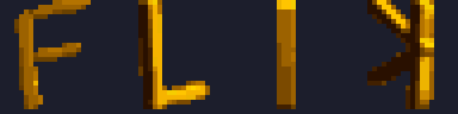
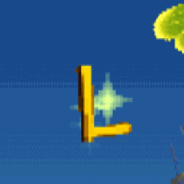

# Pickup Letter Spin Strips (type-0x22 anim art)

The retail in-world F/L/I/K pickup letters are pre-rendered 16-frame voxel-spin
flipbooks, not runtime 3D. This note pins the **format** and the **measured art
profile** of the retail strips so replacement letters can be authored to match.

## Format (retail mechanism)

- RAW **type-0x22 chunk**: `{magic 0x22 u32, tile u32, w u16, h u16}` + `16 × 0x120`
  bytes of 4bpp 24×24 frames (LEVEL07/LEVEL.RAW ch14-17, LEVEL1.RAW ch15-18;
  LEVEL01 equivalents exist per level).
- Generic loader at `0x8003B830` registers any such chunk:
  `anim_table[0x80089638 + tile*4] = payload+8`; native letter tiles are
  `0x10..0x13` (F/L/I/K).
- HUD anim driver `0x80052574` pumps the current frame **every other frame** via
  `upload_anim_frame(tile, 0, frame)` = [[FUNC_80026DF4]] (vsync-queued GP0 A0
  upload into the letter's VRAM cell, 4bpp page (640,0), golden CLUT (880,217));
  spin counter at `0x800A7E28`, **phase stagger 2 per letter slot**.
- The driver does not execute in the START-menu pause loop. The pause shell
  replays the last two resident scene OTs, so adjacent pre-pause spin phases can
  appear to flash without any paused-time letter upload. See
  [[EXP_2026-07-11_training_pause_n_double_buffer_flash]].
- **F and K raw texture-space tiles are U-mirrored** by their draw packets; L and I
  are not (see `mod/glyphs/pickup_letters/README.md` runtime map).

## Measured art profile (pooled F/L/K, pristine LEVEL07/LEVEL.RAW)

Letterform metrics (frame-0 faces):

- 23 rows tall (y 0..22), 16–18 texels wide, ~4 px strokes (`c a a 9` cross-section),
  tapered/flared stroke ends, slight downward lean (+1.5–2 px over the height on the
  F/L stems; K is straight with wobble) — hand-drawn, not geometric.

Shading is **per-frame, per-edge-class** (each horizontal run: Left edge / Interior /
Right edge). CLUT indices are bright→dark 1→15:

| frame(s) | character | L edge | interior | R edge |
|---|---|---|---|---|
| 0, 8 | face-on (8 = mirrored back) | 11–13, darkens downward | ~10, near-uniform | 9 |
| 1, 9 | **specular glint flash** | 14–15 (hard dark rim) | 3–6 (bright) | 2–7 |
| 3–7, 11–15 | oblique/back | 13–15 | dark 12–15 body | bright 7–9 silhouette stripe |
| 4, 12 | edge-on bar | 12–13 | top-bright vertical gradient (5→11) | ~10 |

Whole-strip texel distribution: **~18–21% bright (idx 1–6), ~40–43% mid (7–11),
~37–41% dark (12–15)**. The bright fraction is the "gold sparkle" — flat art with
<2% bright texels reads as matte plastic next to the retail letters (the 2026-07-06
T/R/A/N/G generation failed exactly this way).

## Reference assets

- Exact decoded strips (per-frame PNGs + per-letter spin GIFs, staggered word GIF):
  `mod/glyphs/pickup_letters/reference/` (untracked; regenerate with
  `tools/glyph_spin_native.py` + the extraction snippet in the EXP note).
-  — the four retail strips replayed with the in-game phase stagger.
-  — live capture (SPINNING_L.sav, L1+down).

Mod-side consumer: [[EXP_2026-07-11_native_letter_spin_reference_and_restyle]]
(T/R/A/N/G restyle shaded by quantile-matching these pools);
[[Experiment_-_Training_in-world_TRAINING_pickup_word]] (the TRAINING word mod),
and [[MOD_training_pause_n_suppression]] (Training-only pause N-cell hide).
