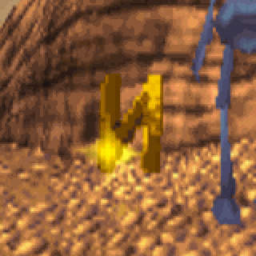
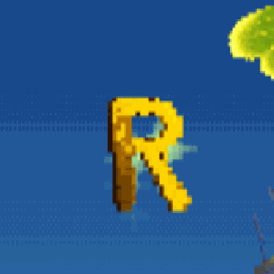
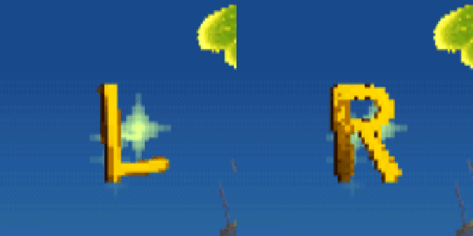

# EXP 2026-07-11 — Native letter-spin reference extraction + T/R/A/N/G restyle

Goal: the modded Training T/R/A/N/G pickup letters looked "off" next to retail
F/L/I/K. Extract the retail spin strips as a reference (frames + GIFs), quantify
the gap, restyle the generated letters to match, and verify on a
**`build/ABL_TRAINING_TEST`** disc (ALLMODS workflow untouched).

## 1. Reference extraction (offline, pristine data)

- Source: `REBUILD/files/LEVEL07/LEVEL.RAW`
  (sha1 `5aa6ff4123cf3fa85fa89b7b16587672411ce618`), decoded with
  `glyph_spin_native.native_letter_strips` (type-0x22 chunks, tiles 0x10–0x13).
- Output: `mod/glyphs/pickup_letters/reference/` — 16 frames × 4 letters as PNGs
  (`native_<L>_fNN.png`), per-letter spin GIFs, `native_FLIK_frame0.png`, and
  `native_FLIK_spin_staggered.gif` (phase stagger 2/slot as in-game).
- Vault copies: 

## 2. What was off (measured, not guessed)

Frame-0 faces of the old generated letters were statistically fine (mean CLUT idx
~10.15 vs native ~10.16). The gap was in the **spin frames** and **letterforms**:

- whole-strip bright texels (CLUT 1–6): native **17.5–21.4%** vs generated **0.9–1.6%**
  — no glint flash (frames 1/9), no bright silhouette stripe on oblique frames;
- dark texels: native ~39% vs generated ~27–31% (weak extrusion shading);
- letterforms: upright, uniform-width, font-like strokes vs native tapered,
  slightly leaning, hand-drawn strokes 23 rows tall.

Full profile pinned in [[SYS_pickup_letter_spin_strips]].

## 3. Fix (tools/glyph_spin_native.py rewrite)

- **Letterforms**: tapered polygon strokes (per-end widths, round caps, arc
  polylines) at native metrics — 23 rows tall, ≤18 wide, ~3.5 px strokes,
  `_LEAN = 1.4` px shear over the height (retail L/F stems drift +1.5–2 px).
- **Shading**: no hand-tuned palette. Each rendered frame is shaded by
  **quantile-matching per frame, per edge-class (L/I/R per horizontal run)**
  against the pooled retail F/L/K strips *from the same RAW being patched*
  (`native_class_pools`). Rank key from the voxel renderer: viewer-proximity
  (z-buffer), skin vs extrusion, a row term weighted by |sin θ| (edge-on frames
  get the native top-bright gradient, face-on frames stay uniform), and a
  deterministic per-texel hash jitter (no RNG — reproducible builds).
- Result distribution: generated strips now land at ~19–20% bright / ~41% mid /
  ~39% dark — matching native. Preview:
  
- `tools/generate_training_pickup_letters.py` rewritten to render its PNGs from
  this live pipeline (frame 0 of the real strips) so the asset folder can no
  longer drift from what ships on disc.

## 4. Verification on ABL_TRAINING_TEST

- Build: `python mod/build.py --mods mod/mods.yaml --out build/ABL_TRAINING_TEST`
  (same manifest as ALLMODS; new output name only). All embedded-file checks OK.
- Smoke gate: `mod/smoke_test.py --disc build/ABL_TRAINING_TEST.cue` —
  **BOOT/ALIVE/RENDER/WALK all PASS** (flik_x 197088, health 5, lives 5,
  changed_pixels 16872, moved_xz 137192).
  - Gate fix landed: the boot movie ends on the LEVEL01 "press ⊗ start" stall and
    layout-shifted discs desync its Cross press → `check_boot` now taps Cross
    between advance chunks once `movie.status` reports playback ended.
- In-world (isolated instance, port 23466, config `/tmp/dsrepro-caps`):
  - Training reached via `movies/ALLMODS_Training_Still.movie.json` (replays 1:1 —
    ALLMODS and TRAINING_TEST images are byte-identical in size/layout).
  - Letter row confirmed at the mod's type-0x3f coords (records at
    `[0x80096e9c]+4+N*0x10`, world = record<<5); teleported beside entry 62 and
    captured a full revolution: 
- Same-camera A/B (operator's `SPINNING_L.sav`, hold L1+down, disc
  `build/ABL_ALLMODS.cue`): the state's RAM holds the **retail L strip** →
  captured as the native in-game reference; then the new **R** strip was written
  over the RAM anim slot (`[0x80089638+0x11*4]+4`) and recaptured from the
  identical camera:
  - native: 
  - new art: 
  - side-by-side: 

## Gotchas (new, prepaid)

- `emulator.loadMedia` does **not** survive `debugger.reset` — the reset reboots
  the *launch* disc. Relaunch the instance to actually change discs for a
  from-boot replay.
- `collecting_FLIK_LEVELTRAINING.movie.json` and
  `ALLMODS_COLLECTING_TRAINING.movie.json` desync on current discs (recorded on
  the 2026-07-06/07 layouts); `movies/ALLMODS_Training_Still.movie.json`
  (2026-07-11) replays on today's layout.
- For a stable spin capture without a save state: pin Flik by rewriting XYZ every
  frame (write → advance 1 → repeat) — the follow camera settles while physics
  never accumulates a fall.

## Follow-ups

- ALLMODS itself still carries the old blocky letters — rebuild
  (`mod/smoke_test.py --build`) when the operator wants the new art in the main
  disc; no manifest change needed (art comes from the rewritten generator).
