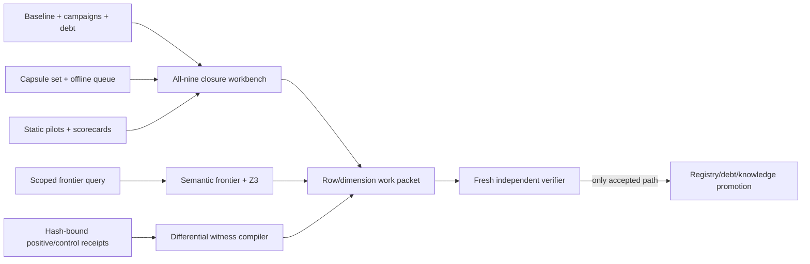

# Phase 4 - Frontier Closure Workbench

**Navigation:** [[Phase 4 - Solve Every Gameplay and Engine Subsystem|Phase 4 roadmap]] · [[Phase 4 - Acceleration Tooling Strategy|Accepted acceleration strategy]] · [[Phase 4 - Reverse Engineering Operating Method|Operating method]]

## Outcome

The closure workbench is implemented as a **review-candidate toolchain**. It turns the
107-row Phase-4 baseline into 963 explicit obligations (107 rows × nine Definition of
Done dimensions), compiles scoped Item-2 frontiers with concrete Z3 address witnesses,
builds matched positive/control runtime witnesses, and refuses to promote a row or
dimension.

This implementation deliberately has two stopping points:

1. a tool may say that a packet is ready for a fresh verifier; and
2. only the existing independent verifier may bank a claim in the campaign registry.

The workbench does not edit `config/phase4_campaigns.yaml`, the closure-debt ledger,
findings, Canon, or MOD state. It does not launch DuckStation. No DuckStation API change
was needed: retained capsules plus the existing `accessHistory`, `execTrace`,
conditional-breakpoint, state-fingerprint, and atomic-capture surfaces cover the
current preflight contract.

## Why Item 2 is exceptionally hard

Item 2 is not “find every textual reference to an address.” It asks whether every
relevant caller, callee, callback, indirect table, overlay, reader, writer, and
downstream consumer has been enumerated, and whether every remainder is bounded. A
positive hit is easy; a sound exclusion is the expensive part.

### 1. The universe is part of the proof

A result is meaningless until it states which executable, overlays, address windows,
record extents, and lifetimes are in scope. Resident-only results miss swapped code.
One-level results miss campaign variants. Same virtual addresses in two overlays are
not the same function. An incomplete function census can make a scan look exhaustive
while omitting reachable text.

The compiler therefore keys images independently, hash-binds each image, requires a
census-completeness disposition, and reports scoped readiness rather than silently
turning a local result into a row-wide claim.

### 2. MIPS effective addresses hide the interesting reference

Direct `lui` plus displacement searches cover only the simplest accesses. Real code
forms pointers through `$gp`, copied registers, signed or unsigned indices, affine
scales, callbacks, tables, callees such as `memset`, and values born far from their
eventual load/store. E16 already demonstrated the failure mode: a compiler-hoisted
load used a register base and touched the watched window before its bounds branch.

`tools/phase4_semantic_frontier.py` solves the bounded affine subset with Z3. It models
signed ranges, congruence, no-wrap and 32-bit-wrap arithmetic, and emits a concrete
`{index, effective_address}` witness for every satisfiable intersection. Solver
`unknown` or timeout remains unknown. It is never rewritten as “disjoint.”

### 3. Indirect control flow makes absence non-local

An unresolved `jalr`, callback registrar, event-program selector, function table, or
overlay entry can add an unbounded family of readers and writers. A depth-limited call
walk cannot close this. Each indirect target set must be declared independently as
complete, left unknown, or handed to an explicit boundary owner whose declaration is
actually consumed by the graph. Stale, unused boundary-owner declarations now block
readiness.

### 4. Callers and callees are asymmetric

Walking outward from roots finds callees but not every caller. Store-site censuses also
miss writes performed by callees. The B06 history is the canonical example: a
transition clear was a `memset(player_block, 0, 168)`, not a store whose immediate
looked like the target field. A complete packet must carry both the forward graph and
an independently derived caller/callee or call-site surface.

### 5. Materialization proves intention, not every incidental touch

E16's materialization census is powerful because code cannot deliberately construct a
constant window address without materializing a compatible base. It does not prove
that pointer arithmetic can never wander into that window. The workbench preserves
this distinction: E16's five known materialization sites and 30 bounded residuals are
review-ready only for the three registered-chunk pointer tables, not for the entire
`E16_streaming_overlays` row.

### 6. Runtime silence cannot prove an untaken path absent

A capsule or movie says what executed at its anchor. It cannot prove that an unvisited
branch, stage, mode, callback target, or transition would not intersect the state. A
frame-boundary capsule also cannot name the exact instruction or DMA/GPU/SPU cause.
Runtime work is therefore a falsifier and a source of concrete witnesses, not a
universal negative proof.

### 7. “Bounded residual” has a strict meaning

A residual is not a bag for unexplained work. It must name the boundary, evidence,
next falsifying experiment, proof basis, covered unknown IDs, and explicitly state
that it does not intersect the scoped dimension. Unknowns must be covered exactly
once. Covering a known intersection, double-covering an unknown, or leaving one
uncovered blocks the review verdict.

### 8. Source identity and source presence differ

Four E08 callback sources intentionally live under gitignored `asm/hand_written`.
Importing those protected bytes merely to make a clean-checkout test green would
violate preservation policy. The static pilot now reports both facts separately:

- `source_bytes_present` says whether the external bytes exist locally; and
- `source_verified` says whether identity passed the applicable contract.

Tracked C must hash directly. An absent external assembly source passes identity only
when `tools/repro_inputs.sha256` contains its exact declared hash. This validates
identity, not source behavior or matching-source closure.

### 9. Item-2 readiness is not compiler strict closure

The semantic compiler emits two predicates:

- `strict_frontier_closed`: the declared compiler universe has no unknown graph edge,
  unknown access, missing category, incomplete image census, or stale boundary owner;
- `item2_ready_for_review`: every required category is enumerated and every remaining
  unknown is covered once by a valid, non-intersecting residual.

The second predicate can be true while the first is false. Neither promotes Item 2.
This is the important correction to the earlier, overly strong reading that Item 2
required the compiler's unknown set itself to be empty.

## Implemented architecture



### Files

| Surface | Path | Role |
|---|---|---|
| all-nine policy | `config/phase4_closure_workbench.yaml` | exact dimension layers, questions, accelerators, pilot adapters, capsule-first escalation, and non-promotion authority |
| workbench | `tools/phase4_closure_workbench.py` | joins all 107 rows, claims, debt, capsules, pilots, scorecards, fixtures, and inventory into packets |
| retained diagnostic | `analysis/phase4_closure_workbench.json` | deterministic 963-obligation snapshot; currently red on stale integration receipts |
| Item-2 compiler | `tools/phase4_semantic_frontier.py` | validates a strict query schema, traverses direct/indirect/callback edges, solves affine intersections, and compiles residual coverage |
| runtime witness compiler | `tools/phase4_witness_compiler.py` | requires matched origin, Interpreter identity, exact perturbation universe, clean controls, and assertions for every observed difference |
| static pilot | `tools/phase4_static_frontier.py` | retained E15/E08/C13 application plus manifest-safe external assembly identity |
| dependency pins | `tools/requirements.txt` | PyYAML 6.0.3, Z3 4.16.0.0, Unicorn 2.1.4, DuckDB 1.5.5, NumPy 2.5.1 |

The semantic and witness tools use exact-key schemas. Unexpected fields fail instead
of being ignored. Both can write deterministic summaries under the repository and
support byte-exact `--check`. Neither accepts an output path outside the repository.

## The nine dimensions as executable work

| # | Dimension | Required proof surface | Tool-assisted next move |
|---:|---|---|---|
| 1 | Original oracle | fixture identity, assertions, positive and negative controls, provenance | compile the smallest matched positive/control receipt with `phase4_witness_compiler.py` |
| 2 | Complete frontier | universe, roots, callers/callees, indirects, callbacks, reads/writes, overlays, bounded residuals | compile a scoped query with `phase4_semantic_frontier.py`; use the witness address as a falsifier |
| 3 | Typed state | fields, widths, signedness, owners, domains, initialization/reset | use the work packet to join frontier accesses against semantic-state and record schemas; missing layers remain explicit |
| 4 | Lifecycle | creation, reuse, retirement, death/respawn, pause, transition/reload, persistence | query retained transitions first; request one missing transition witness only after capsule preflight |
| 5 | Original interfaces | call/return, registers, stack/RA, HI/LO, GTE/delay slots, memory effects, callback/overlay/asset ABI | generate an ABI ledger; use the bounded Unicorn oracle only for pure/RAM-local questions |
| 6 | Campaign breadth | applicability universe, stages, variants, modes, exceptional paths, controls | derive cells from authored data and registries, then choose the minimum identity-compatible fixture cover |
| 7 | Cross-system behavior | producer/consumer interaction universe and matched controls | rank dependency intersections and compile one-variable positive/control witnesses |
| 8 | Source closure | extent, assembly identity, semantic/matching source, layouts, mismatch ledger, executable guards | bind every frontier block and field to source or an explicit mismatch; never infer source closure from byte pins alone |
| 9 | Durable evidence | Canon/Experiment/MOD placement, pins, regeneration, supersession, clean checkout | use the claim/supersession index and evidence-DAG preflight, then submit to a fresh verifier |

Only Items 1, 2, 7, and the shared control plane gained new general compilers in this
candidate. The remaining rows are fully represented as executable obligations and
adapter contracts; their specialized accelerators remain follow-on implementations,
not falsely claimed finished tools.

> **Follow-on delivered (2026-08-05):** the Item-2 compiler had no way to *obtain* a
> query — authoring one by hand is what kept rows away from it. That feeder now
> exists and Plan Item 1 is closed: see [[Phase 4 - Frontier Extractor]]. It also
> hardened this checker's gate — `mechanical_completeness` is now a hard input, the
> extractor trust root is checker-owned, and `compile_frontier` verifies provenance
> by regeneration instead of accepting a caller's claim.

## Pilot results

The workbench recomputes pilots independently of their prose conclusions:

| Pilot | Recomputed result | Honest boundary |
|---|---|---|
| B06 Item 2 | 251/251 candidate sites classified, 13 residual entries, zero unexplained | `review_ready_but_unregistered`; no campaign registration is invented |
| E16 Item 2 | five materialization sites, 30 residual entries | `scope_limited_review_ready_but_unregistered`; applies only to the three registered-chunk pointer tables |
| E15 Item 2 | retained static benchmark valid | `ready_for_fresh_verifier`; the workbench itself still cannot bank it |
| E08 Item 2 | counts, callback identities, and program joins validate | `not_ready`; an unresolved indirect application boundary remains |
| C13 Item 2 | six static roots and state contract localize correctly | `localization_ready_not_promotion`; causal controls, lifecycle/breadth, and original oracle remain open |

## Standard workflow for a future agent

### 1. Start with the workbench

```bash
python3 tools/phase4_closure_workbench.py build
python3 tools/phase4_closure_workbench.py check
python3 tools/phase4_closure_workbench.py packet \
  --row E08_props_movers_gates --dimension complete_frontier
```

`check` must fail if the retained report is byte-stale **or** if the freshly
recomputed report still reports integration errors. Do not bypass that distinction by
reading a retained `structural_ready` Boolean.

### 2. Consume retained evidence before live work

Inspect the packet's capsule opportunity and query a relevant, validated capsule.
Use its register/RAM/VRAM/SPU/frame-boundary domains where sufficient. If the named
question needs exact instruction, DMA/GPU/SPU attribution, a native behavioral
control, or a missing domain, produce a live preflight:

```bash
python3 tools/phase4_closure_workbench.py prepare-live \
  --row E15_fmv --dimension lifecycle \
  --reason exact_instruction_attribution \
  --missing-domain 'exact first teardown instruction' \
  --positive-control 'same-anchor natural completion' \
  --negative-control 'same-anchor pre-completion hold'
```

This command designs nothing and launches nothing; it only proves that capsule-first
preconditions and matched controls were considered. Supplying an already available
API surface such as `execTrace` as a proposed API gap is rejected.

### 3. Declare and compile the frontier

Create a query using the exact schema enforced in
`tools/phase4_semantic_frontier.py`. Every query must name all eight Item-2 categories,
image identities/extents, target windows, roots, functions and call sites, callback and
indirect-table completeness, boundary owners, affine access domains, residuals, and
the exact non-promotion authority block.

```bash
python3 tools/phase4_semantic_frontier.py config/my_frontier_query.yaml \
  --output analysis/my_frontier_result.json
python3 tools/phase4_semantic_frontier.py config/my_frontier_query.yaml \
  --output analysis/my_frontier_result.json --check
```

An `intersects` result includes a concrete Z3 witness. An `unknown` result demands a
new bound or exactly one well-formed residual. Never transcribe `unknown` as
`disjoint`.

### 4. Compile the smallest causal witness

When runtime evidence is genuinely required, obtain two independently retained,
hash-bound receipts from an isolated Interpreter run. The compiler requires identical
media/executable/overlay/fixture/debugger identity, anchor class, start fingerprint and
start-state hash; the exact perturbation-key universe; non-truncated runs; true control
checks; and an assertion covering every differing observation leaf.

```bash
python3 tools/phase4_witness_compiler.py config/my_witness.yaml \
  --output analysis/my_witness.json
python3 tools/phase4_witness_compiler.py config/my_witness.yaml \
  --output analysis/my_witness.json --check
```

The maximum verdict is `witness_ready_for_fresh_verifier`.

### 5. Bank only through independent review

Run the relevant safe tests, static/frontier checks, inventory/evidence-DAG checks,
and promotion preflight from a committed clean checkout. A verifier must independently
recompute the candidate, examine every bounded residual and scope statement, and only
then update the registry, debt, findings, and knowledge layers.

## Verification and current blockers

Focused implementation validation is green: 60 tests cover exact 107×9 expansion,
pilot recomputation, claim/supersession indexing, path scrubbing, capsule-first live
preflight, Z3 SAT/UNSAT/unknown behavior, wrap and congruence arithmetic, indirect and
callback residuals, stale boundary owners, manifest mutation, matched origins, exact
perturbation universes, assertion completeness, CLI freshness, and non-promotion.

The retained workbench is intentionally **not green overall**. It recomputes and
reports that the retained fixture audit and campaign inventory were generated from a
different source snapshot. The broader merged worktree also exposes pre-existing
control-plane debt: 71 undeclared later Phase-4 generators, 159 orphan later artifacts,
116 stale artifact source-dependency receipts, and externally provisioned campaign
movies whose current bytes do not match their central pins. Those are integration
work, not evidence that may be “fixed” by editing hashes.

Consequences:

- no claim from this candidate is bankable yet;
- the global workbench `check` remains red even though its retained bytes regenerate;
- E08's original-oracle promotion control remains blocked by external fixture drift;
- a fresh detached verifier must review the eventual committed candidate; and
- the dirty operator checkout, copyrighted assets, saves, movies, capsules, traces,
  tokens, and protected assembly bytes remain outside this candidate.

## Acceptance checklist

- [x] 107 rows expanded to exactly nine obligations each.
- [x] Item-2 categories, scope, graph, address, residual, and non-promotion contracts are machine-enforced.
- [x] Z3 version and unknown behavior are pinned and fail closed.
- [x] Positive/control witnesses require matched identity and assert every difference.
- [x] B06, E16, E15, E08, and C13 adapters recompute their own facts.
- [x] Capsule-first live/API-change preflight is implemented without launching an emulator.
- [x] External assembly presence and manifest-pinned identity are reported separately.
- [x] Retained green audit bits are rejected when their source hashes drift.
- [x] Focused mutation and deterministic-regeneration suite passes.
- [ ] Reconcile the newer branch's global Phase-4 inventory and artifact receipts.
- [ ] Restore or deliberately supersede externally drifted fixture movies through the preservation workflow.
- [ ] Commit the exact candidate and obtain a fresh detached verifier verdict.
- [ ] Let that verifier, not this workbench, bank any accepted claims.
